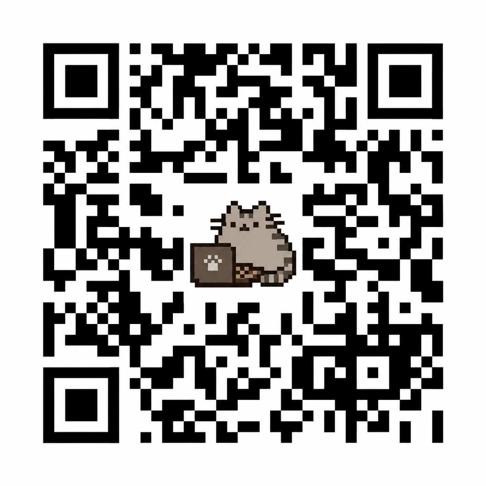

# QR Code Generator
<p align=center>
    
</p>

Build a Python program that turns a URL or short message into a QR code you can scan.

Follow the [GitHub setup instructions](GITHUB_SETUP.md) before starting.

## Learning Goals

Install and use an unfamiliar third-party Python package.


## Program File

Complete the starter functions in `make_qr.py`.

## Library Setup

In your project folder, run:

```
python -m pip install -r requirements.txt
``` 
Import `qrcode` in your program. The Usage example shows how to make and save an image: [qrcode documentation](https://pypi.org/project/qrcode/#usage)

## Requirements

1. Ask for a URL or short message, then an output filename. Repeat either prompt if the response is empty or contains only whitespace.
2. Strip surrounding whitespace from both responses. Preserve spaces and punctuation within the content, including URL query parameters.
3. Use `qrcode` to encode the content and save a PNG. Append `.png` only if the filename doesn't already end in that extension, ignoring case. For example, `lab.PNG` stays `lab.PNG`.
4. After saving, print `Saved ` followed by the final filename.


> [!IMPORTANT]  
> Use the supplied functions in `make_qr.py` and follow their docstrings. Keep the filename, function names, parameter names and order, and return types.

## Input Assumptions

The content fits in a QR code. The filename is valid and its folder exists. Encode URL characters such as `?`, `&`, and `=` exactly as entered.

## Sample Output

```text
URL or text: https://cs50.harvard.edu/python/weeks/4/
Output filename: programming-fundamentals
Saved programming-fundamentals.png
```

## Check Your Work

- Run `python make_qr.py` with the sample inputs. Scan the image and check that both query parameters are present.
- Try `Meet in lab 204` with the filename `lab.PNG`. Check the exact filename and scan the message.
- Press Enter at either prompt. Confirm that the program asks again.

## Submission

Commit and push to `development`. Review and merge your pull request into `main`, then submit your repository URL in Canvas.
